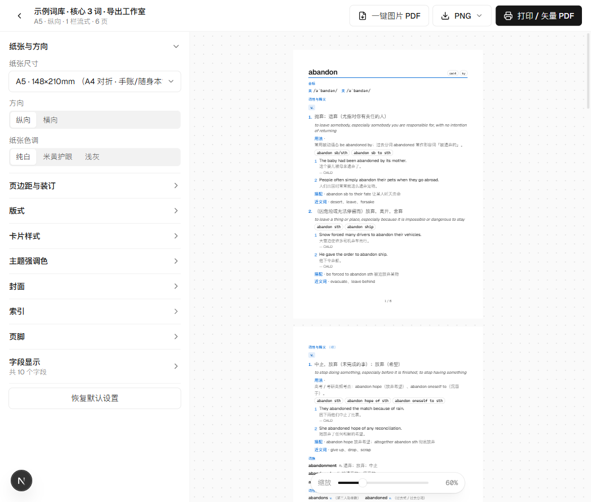

# WulonVocab · 单词本工坊

> 把单词，做成一本真正精美的书。

本地优先（Local-first）的单词本软件：**动态字段管理**、**JSON 一键导入自动排版**、**A4 / B5 / A5 / 16 开打印级导出**。
界面遵循 **Geist 设计系统**（官方 `geist` 字体 + 按官方规范复刻的组件与令牌）。


## 功能总览

| 模块 | 能力 |
| --- | --- |
| 动态字段管理 | 14 种字段类型（音标 / 词性与释义 / 词族 / 词性变换 / 联想 / 例句 / 情景标签 / 表格 / 图片 / 提示块 / 评分 / 列表 / 长短文本 / 分隔线），任意增删、拖拽排序、逐项配置显示选项；内置 5 套模板（牛津词典风 / 极简记忆卡 / 考试冲刺 / 深度阅读 / 空白）；字段改名自动迁移数据；未知数据可「提升为字段」 |
| 词条编辑 | 词性 → 释义 → 用法 / 句型 / 例句 / 近反义词 / 搭配 / 备注 的嵌套编辑；标签、状态（未学/在学/已掌握）、星标；右侧**实时预览**导出样式 |
| 词典检索 | 可插拔数据源：Free Dictionary API（免费）、**本地词库**（导入 OALD / ECDICT 数据集离线检索）、AI 生成（任何 OpenAI 兼容接口，按当前字段表动态出题）、自定义 HTTP API；支持单词检索与**批量单词表**导入 |
| 导入 | WulonVocab 文档 / 词条数组 / 「单词→内容」字典 / NDJSON / CSV / TSV；ECDICT 结构自动映射（音标、分行释义、交换码词形、考纲标签）；**无 schema 时自动推断字段类型**；宽容归一化（字符串 / 数组 / 对象多形态） |
| 导出工作室 | 纸张：A4 / A5 / B5(ISO) / B5(JIS) / 16 开 / 32 开 / 自定义；1–3 栏流式分栏（仿词典）或网格闪卡；**矢量 PDF（打印另存，文字可搜索）**、**一键图片型 PDF**、**PNG（最高 384 DPI，支持 ZIP 打包）**；封面 4 风格、索引页（带页码）、页脚、跨页「续」标、镜像装订边距、米黄护眼纸色、宋体/无衬线、手写横线（可打印成手写词卡） |
| AI Skill | `skill/wulonvocab-json/`：教任意 AI（Kilo / Claude / Cursor / ChatGPT…）按规范输出可直接导入的 JSON，含字段参考、完整示例与零依赖校验脚本 |



## 快速开始

```bash
npm install
npm run dev          # http://localhost:3000
```

打开首页 → 「创建示例（3 词）」即可体验完整流程：编辑 → 实时预览 → 导出工作室 → 打印装订。

### 在线版（GitHub Pages）

已配置静态托管：<https://incoruptus.github.io/wulonvocab/>（推送 `main` 后由
[`deploy-pages.yml`](.github/workflows/deploy-pages.yml) 自动构建部署）。

- 静态托管下采用查询参数路由（`/book?id=…`），无需服务器；
- 部署产物本地预览：`npm run build:pages && npm run serve:pages` → <http://localhost:4010/wulonvocab/>；
- 首次部署若 Actions 无权自动开启 Pages，请在仓库 Settings → Pages 把 Source 设为 **GitHub Actions**。

### 常用命令

| 命令 | 说明 |
| --- | --- |
| `npm run dev` / `build` / `start` | 开发 / 生产构建 / 生产启动 |
| `npm run build:pages` / `serve:pages` | 构建 GitHub Pages 静态站点（out/）/ 本地预览产物 |
| `npm run typecheck` | TypeScript 全量类型检查 |
| `npm run lint` | ESLint（含 React Hooks 规则） |
| `npm test` | Vitest 单元测试（归一化 / 分页 / 导入） |
| `npm run sync:skill` | 将 `skill/` 同步到 `public/downloads/`（应用内下载） |
| `npm run validate -- <file.json>` | 用 Skill 自带的零依赖脚本校验词表 JSON |

## 项目结构

```
WulonVocab/
├─ src/
│  ├─ app/                  # Next.js App Router 路由（仪表盘/工作区/导出工作室/设置/Skill）
│  ├─ components/
│  │  ├─ ui/                # Geist 风格组件原语（按钮/输入/弹层/Tabs…）
│  │  ├─ book/              # 词条列表、动态编辑器、字段设计器
│  │  ├─ value/             # 14 种字段类型的渲染器与编辑器
│  │  ├─ export/            # 测量-分页-排版引擎与导出工作室
│  │  ├─ lookup/ import/    # 检索面板、导入向导
│  │  └─ app/               # 应用外壳（顶栏、Providers）
│  └─ lib/                  # 领域层：类型、字段注册表、归一化、Store、检索、导入、分页、打印
├─ skill/wulonvocab-json/   # AI Skill（SKILL.md + references + examples + validate.mjs）
├─ docs/                    # 架构、数据格式、导出指南、调研报告、ADR、路线图
└─ public/downloads/        # 应用内可下载的 Skill 资源（由 sync:skill 生成）
```

## 数据与隐私

- 所有数据保存在浏览器 **IndexedDB**（词库、设置、本地词库），不上传任何服务器；
- 词库可随时导出 JSON（含字段表）备份或迁移；设置页提供全量备份/恢复；
- 检索仅在你触发时请求所配置的数据源；API Key 仅存本机。

## 文档

- [架构说明](docs/ARCHITECTURE.md) · [数据格式](docs/DATA-FORMAT.md) · [导出指南](docs/EXPORT-GUIDE.md)
- [调研报告](docs/RESEARCH.md)（Geist 设计系统 / 打印导出技术 / 词典字段体系）
- [路线图](docs/ROADMAP.md) · [变更日志](CHANGELOG.md) · 架构决策记录 [docs/adr](docs/adr/)

## 技术栈

Next.js 16（App Router, Turbopack）· React 19 · TypeScript · Tailwind CSS v4 · Zustand + IndexedDB · Radix Primitives · dnd-kit ·
html-to-image · jsPDF · JSZip · PapaParse · Vitest。字体：官方 `geist` 包（自托管，无外部字体请求）。

## 许可与数据来源说明

代码供个人学习与使用。示例数据中的词典例句标注了出处（OALD 等），仅用于演示字段结构；
商业使用请自行核实并替换为有授权的数据。导入的第三方词库（ECDICT / OALD 数据集等）版权归其原作者所有。
